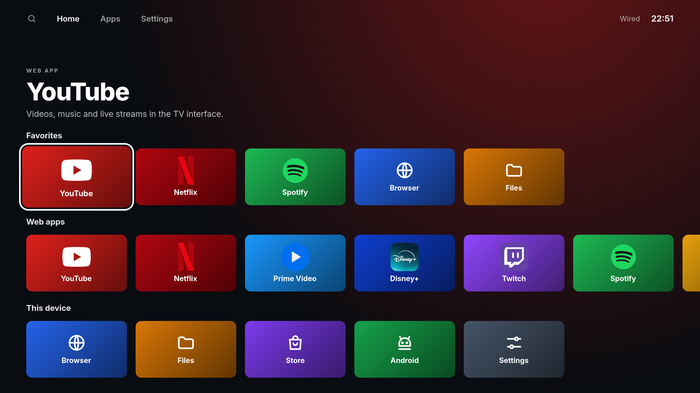
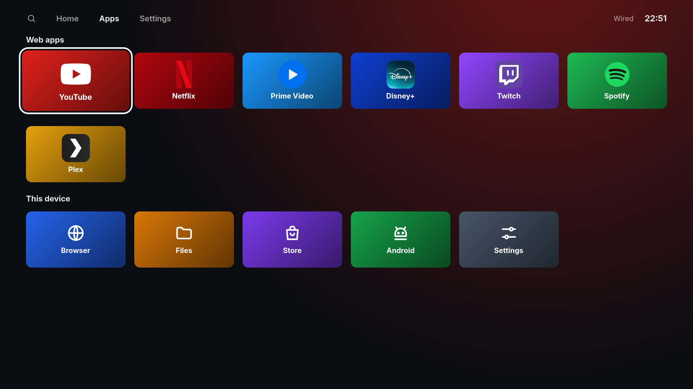
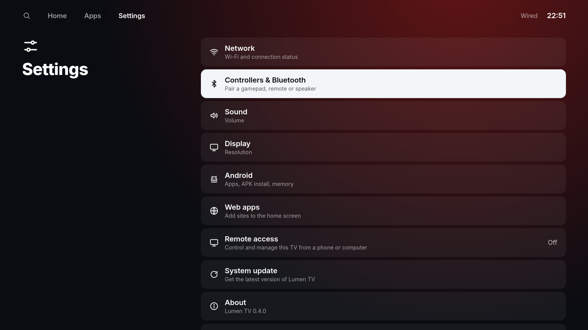
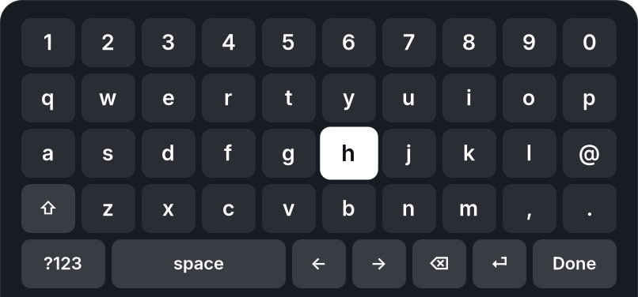
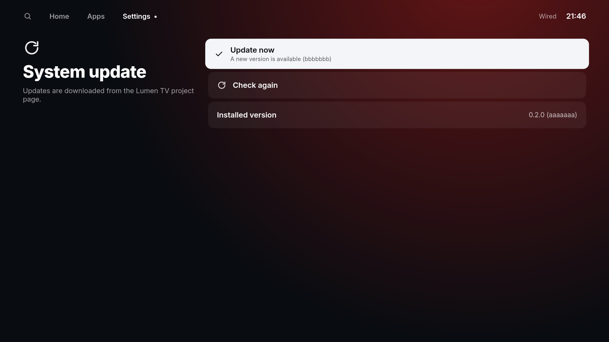

# Lumen TV

A lightweight TV system for the Raspberry Pi that looks and behaves like
Android TV: a full-screen launcher you drive from the sofa with a game
controller, with Android apps, web apps and your own media.



| | |
|---|---|
|  |  |

## What it is

Lumen TV is not a fork of Android. It is Raspberry Pi OS Lite with a small
custom shell on top:

| Part | What does it |
|---|---|
| Home screen, settings, file browser | `lumen-shell`, a GTK 4 app written for this project |
| Controller support, on-screen keyboard | `lumen-input`, a small daemon written for this project |
| Windows | [sway](https://swaywm.org), used only as invisible plumbing |
| Android apps | [Waydroid](https://waydro.id), an Android container with direct GPU access |
| Web apps and browser | Chromium in kiosk mode |
| Linux apps and the Store | [Flatpak](https://flatpak.org) with [Flathub](https://flathub.org) |
| Remote access from a phone or PC | `lumen-remote`, a small web server written for this project |
| Video, music, photos | mpv and imv |

There is no desktop underneath, so an idle system is the launcher and little
else. Android and the browser only use memory while you use them.

## Requirements

- Raspberry Pi 4 or 5 (4 GB or more recommended if you want Android apps)
- Raspberry Pi OS Lite, 64-bit, based on Debian 13 "trixie" or newer
- A game controller (USB or Bluetooth), a keyboard, or a TV remote over HDMI-CEC

## Install

Flash Raspberry Pi OS Lite (64-bit) with Raspberry Pi Imager, boot it, connect
it to the network, then:

```sh
sudo apt install -y git
git clone https://github.com/AdamD2077/lumen-tv.git
sudo lumen-tv/install.sh
sudo reboot
```

The Pi now boots straight into Lumen TV. `sudo ./install.sh --no-android`
leaves out Android support; `--uninstall` removes Lumen TV again.

The installer adds Waydroid's apt repository by running their install script
(`https://repo.waydro.id`) as root, which is how Waydroid documents it.

### Building a ready-to-flash image

`image/build.sh` builds a complete image with
[pi-gen](https://github.com/RPi-Distro/pi-gen) (needs Docker). The workflow in
`.github/workflows/image.yml` does the same on GitHub and attaches the image to
the run. The image's user is `tv` with password `lumen`; SSH is off.

## Using it

| Controller | Does |
|---|---|
| D-pad / left stick | Move |
| A | Select |
| B | Back |
| Start | Options for the focused app (favorite, close, remove) |
| Select or Guide | Home. Hold it to close the current app |
| Right stick | Mouse pointer, for websites and touch-only Android apps |
| RT or right-stick click / LT | Click / right click |
| LB / RB | Scroll up / down |
| Top face button (Y on Xbox, △ on PlayStation) | Open the on-screen keyboard |
| Left face button (X on Xbox, □ on PlayStation) | Play / pause |

Buttons are matched by position, so a Nintendo-layout pad has A and B swapped.

**On-screen keyboard.** It opens by itself in Lumen TV's own text fields and
with the top face button anywhere else, including inside websites and Android
apps. Move with the D-pad, A types, B closes, LB is shift, RB switches to
symbols, Start is Enter, the left face button is backspace and the top one is
space. Click the left stick to move the keyboard to the other edge of the
screen if it covers what you are typing.



A USB keyboard works everywhere too: arrows, Enter, Escape, Menu, and
`Super+H` for home, `Super+Q` to close an app, `Super+K` for the on-screen
keyboard.

**Android apps.** Open Settings › Android › Set up Android once (about 1 GB).
Apps you install then show up on the home screen. Install APKs from a USB
drive with Settings › Android › Install an APK, or choose "with Google apps"
during setup for the Play Store. To run an Android TV build instead of the
standard tablet one, put its `system.img` and `vendor.img` in
`/etc/waydroid-extra/images/` before setting up (see
[WayDroid-ATV](https://github.com/WayDroid-ATV/waydroid-androidtv-builds)).

**Web apps.** Any website can be a full-screen app: Settings › Web apps › Add
a web app. YouTube is preconfigured to load its TV interface, which is fully
controller-driven. Each web app's tile shows the site's own icon, downloaded
from the site the first time and cached (nothing is bundled).

**Store.** The Store tile lists Linux apps from Flathub, filtered to those
built for the Pi's processor. Search, install and remove with the controller;
installed apps appear on the home screen. Apps are installed for the TV user
only, so no administrator rights are involved. Not every desktop app is
pleasant with a controller: use the right stick as a mouse.

**Android app stores.** With Android set up, Store and Settings › Android
offer to install **F-Droid** (open-source apps) and **Aurora Store** (apps from
Google Play without a Google account). Both are downloaded from f-droid.org.

**Display.** Settings › Display › Resolution lists every mode your TV offers.
A new resolution has to be confirmed within 15 seconds or the previous one
returns, so a mode your TV cannot show never leaves you with a black screen.
"Automatic" stays at 1080p, which is the smoothest on a Pi. If moving around
still feels slow, turn off Animations on the same page, and check
Settings › About › Graphics: it should say GPU, not Software.

**Files.** USB drives mount themselves and appear under Files. Photos open in
a full-screen viewer (left/right to browse), videos and music in mpv.

## Remote access

Manage the TV from a phone or computer, in a web browser, with nothing to
install. Turn it on under **Settings › Remote access**; the TV then shows an
address (for example `http://192.168.1.50:8080`) and a six-digit PIN. Open the
address on a device on the same network and enter the PIN once.

- **Remote:** D-pad, OK, Back, Home, Menu, volume and play/pause. Type text on
  the TV from your phone's keyboard, or send a link to open on the TV. On a
  computer the arrow keys, Enter and Escape work as the remote.
- **Apps:** open or close apps, add and remove web apps, and upload an `.apk`
  to install in Android.
- **System:** memory, temperature and uptime, update Lumen TV, restart or shut
  down, and read the session log.

It is off by default. Pairing locks for five minutes after five wrong PINs, and
**Change PIN** signs out every paired device. The connection is plain HTTP, so
it is meant for your home network: do not forward the port to the internet.
There is no terminal in the web page; for a shell, enable SSH separately.

## Updating

Lumen TV updates itself from this repository. Open **Settings › System
update** and choose **Update now**; the launcher restarts on the new version
when it is done. It also checks shortly after start-up and marks the Settings
tab with a dot when an update is waiting.



An update downloads the latest `main` branch and re-runs the installer, so new
dependencies are picked up too. Anything pushed to `main` is therefore what
every device installs next. The source is set in `/etc/lumen/update.conf`
(`REPO=` and `BRANCH=`), in case you want a device to follow a fork or a
testing branch. The log is `/var/log/lumen-update.log`.

## Configuration

Settings are stored in `~/.config/lumen/config.json` (web apps, favorites,
hidden apps, search engine, whether 4K TVs are driven at 1080p). Logs are in
`~/.cache/lumen/session.log`.

## Status

Developed and tested on a desktop PC; **not yet run on a Raspberry Pi.**

Verified:

- The launcher: every screen, navigation, the add-web-app flow, menus and the
  file browser (`tools/screenshot.py` renders the screenshots above).
- The controller daemon, end to end against a virtual gamepad: detection,
  button mapping, key repeat, pointer, hot-unplug.
- The updater script against a local git repository: check, apply, a second
  update, and the failure cases (server unreachable, bad download).
- Remote access: pairing, PIN lock-out, refusal of unpaired and cross-site
  requests, the remote keys, typing, and web app management, against the real
  server. The web page itself has **not** been viewed in a browser yet.
- `python3 -m unittest discover tests` covers the controller mapping, keyboard
  layout, sway protocol, app catalogue, settings parsing, resolutions, icons, the store, remote access and the updater.

Not yet verified, because they need the real hardware:

- `install.sh`, the boot-to-TV session and the sway configuration
- A full in-system update on a device (it re-runs `install.sh` as root)
- Waydroid on the Pi (GPU acceleration, start-up time, app compatibility)
- Installing and running Flatpak apps, and installing the Android stores
- Chromium kiosk behaviour and whether the streaming sites accept it (DRM
  services need Widevine, which the installer adds only if the OS provides it)
- The on-screen keyboard as an overlay above other apps
- HDMI-CEC remotes
- The image build

Expect to fix a few things on first boot.

## Layout

```
lumen/        the launcher and input daemon (Python)
bin/          session, launcher scripts, updater and the Android helper
config/       sway, mpv and imv configuration
install.sh    installer for Raspberry Pi OS Lite
image/        pi-gen stage for building a flashable image
tests/        unit tests
tools/        screenshot tool
```
